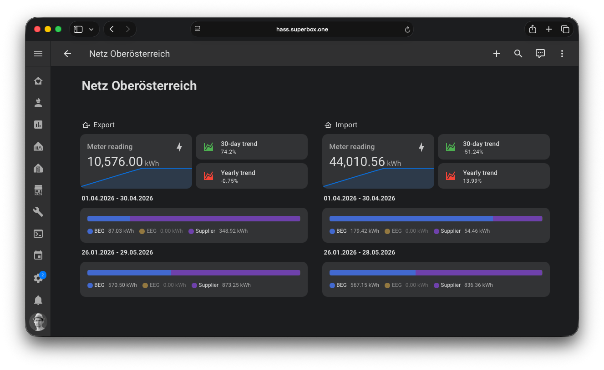

# Netz OÖ eService

[][workflow-ci]

![Typing: strict][typing-strict]
![Code style: Ruff][code-ruff]

A Home Assistant integration to read energy data from the [Netz OÖ eService portal](https://eservice.netzooe.at).

> [!NOTE]
> This is an unofficial integration. It is not affiliated with or supported by Netz Oberösterreich GmbH.

[workflow-ci]: https://github.com/superbox-dev/netzooe_eservice/actions/workflows/ci.yml
[typing-strict]: https://img.shields.io/badge/typing-strict-green.svg
[code-ruff]: https://img.shields.io/endpoint?url=https://raw.githubusercontent.com/charliermarsh/ruff/main/assets/badge/v1.json

## Requirements

- Home Assistant 2026.9.4 or newer with [HACS](https://hacs.xyz/) installed.
- An account for the Netz OÖ eService portal.

## Installation

[][redirect-hacs]

1. Install this integration with HACS (search for "Netz OÖ eService"). For a manual installation, copy the
   `custom_components/netzooe_eservice` directory into the `custom_components` directory of your Home Assistant
   configuration.
2. Restart Home Assistant.
3. Go to **Settings** → **Devices & services**, click **+ Add integration** and select **Netz OÖ eService**.
4. Enter the username and password of your Netz OÖ eService portal account.

To change the credentials later, select **Reconfigure** in the integration's menu.

[redirect-hacs]: https://my.home-assistant.io/redirect/hacs_repository/?owner=superbox-dev&repository=netzooe_eservice&category=integration

## Options

Open **Settings** → **Devices & services** → **Netz OÖ eService** → **Configure** to change these options:

| Option                                                          | Default  | Description                                                                                                                               |
|-----------------------------------------------------------------|----------|-------------------------------------------------------------------------------------------------------------------------------------------|
| Frequent updates (every 15 minutes)                             | Disabled | Refresh the energy community contribution factors and statuses every 15 minutes. When disabled, all data is refreshed every 3 hours only. |
| Show revoked energy communities                                 | Disabled | Show revoked energy communities as separate devices and include their values in the total sensors.                                        |
| Include data from inactive contract accounts (same meter point) | Enabled  | Merge data from contract accounts with inactive suppliers at the same meter point into the active account's data.                         |
| Show inactive meter points                                      | Disabled | Show meter points where all contract accounts are inactive, using the data of the most recently ended contract.                           |

## Data updates

All data is refreshed every 3 hours. With **Frequent updates** enabled, the contribution factors and statuses of
the energy communities are additionally refreshed every 15 minutes.

Sensors marked with "16-day delay" contain values that the portal only provides with a delay of about 16 days.

## Changelog

See [CHANGELOG.md](CHANGELOG.md). The format is based on [Keep a Changelog](https://keepachangelog.com/en/1.1.0/).

## Get involved

The **Netz OÖ eService** integration is an open-source project and contributions are welcome. You can:

- Report [issues](https://github.com/superbox-dev/netzooe_eservice/issues/new/choose) or request new features
- Improve documentation or translations
- Contribute code
- Support the project by starring it on GitHub ⭐

Read [CONTRIBUTING.md](CONTRIBUTING.md) to get started.

## Donation

I put a lot of time into this project. If you like it, you can support me with a donation.

[][kofi]

or [donate with PayPal](https://www.paypal.com/donate?hosted_button_id=34ZFWTH4TNLXS)

[kofi]: https://ko-fi.com/F2F0KXO6D
