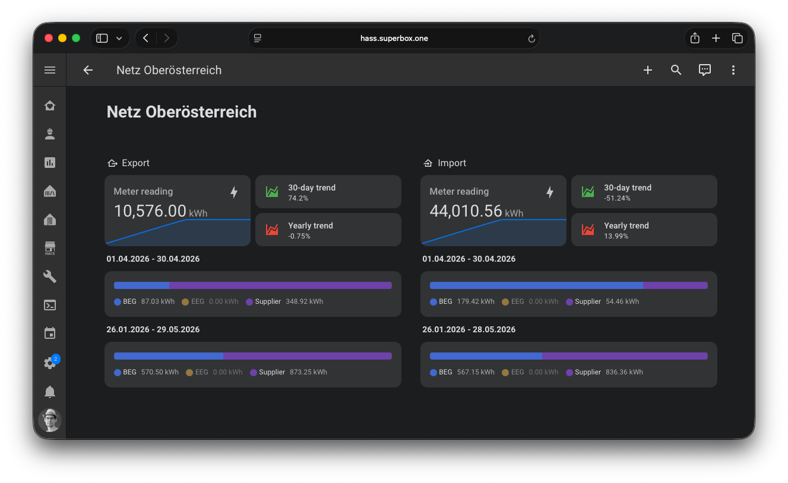

The **Netz OÖ eService** integration reads the energy data of your electricity meter points from the
[Netz OÖ eService portal](https://eservice.netzooe.at) of Netz Oberösterreich, the grid operator in Upper Austria.
It provides the meter readings, the monthly and yearly consumption trends, the peak power of the previous month and,
if your meter point takes part in an energy community (Energiegemeinschaft), the energy shared with the community.

:::note[Unofficial integration]

This is an unofficial community integration. It is not affiliated with or supported by Netz Oberösterreich GmbH.
For support, open an [issue](https://github.com/superbox-dev/netzooe_eservice/issues/new/choose), do not contact
Netz Oberösterreich.

:::



## Use cases

- Show the meter reading and the consumption of the current and previous month or year on a dashboard.
- See how much of your consumption is covered by your energy community and how much still comes from your supplier.
- Track how much energy your photovoltaics system shares with the energy community.
- Get notified when the participation in an energy community changes, e.g. when it is revoked.
- Check the peak power of the previous month, e.g. to plan a heat pump or a wallbox.

## Supported devices

The integration creates a device for each electricity meter point of your account:

- **Household** (Haushalt): meter point that imports energy from the grid
- **Photovoltaics** (Photovoltaik): meter point that exports energy to the grid

Each energy community that a meter point takes part in gets its own device, linked to the device of the meter point.

## Prerequisites

- Home Assistant 2026.9.4 or newer.
- An account for the [Netz OÖ eService portal](https://eservice.netzooe.at). Log in once in the browser to make sure
  that your meter points are shown there.

## Installation

[][redirect-hacs]

1. Go to **Settings** → **Marketplace**, search for **Netz OÖ eService** and select **Install**.
2. Follow the setup that starts after the installation.

For a manual installation, copy the `custom_components/netzooe_eservice` directory of the
[latest release](https://github.com/superbox-dev/netzooe_eservice/releases/latest) into the `custom_components`
directory of your Home Assistant configuration, restart Home Assistant and add the integration under
**Settings** → **Devices & services** → **+ Add integration**.

[redirect-hacs]: https://my.home-assistant.io/redirect/hacs_repository/?owner=superbox-dev&repository=netzooe_eservice&category=integration

## Configuration

To add the **Netz OÖ eService** integration to your Home Assistant instance, use this My button:

[][redirect-config-flow]

Or go to **Settings** → **Devices & services**, select **+ Add integration** and search for **Netz OÖ eService**.

| Parameter | Description                                                                    |
|-----------|--------------------------------------------------------------------------------|
| Username  | The username of your Netz OÖ eService portal account, e.g. your email address. |
| Password  | The password of your Netz OÖ eService portal account.                          |

To change the credentials later, select **Reconfigure** in the menu of the integration entry. If the portal rejects
the credentials, e.g. after a password change, Home Assistant asks you to enter the new password.

[redirect-config-flow]: https://my.home-assistant.io/redirect/config_flow_start/?domain=netzooe_eservice

## Options

To change the options, go to **Settings** → **Devices & services** → **Netz OÖ eService** and select
**Configure**.

| Option                                                          | Default  | Description                                                                                                                                    |
|-----------------------------------------------------------------|----------|------------------------------------------------------------------------------------------------------------------------------------------------|
| Frequent updates (every 15 minutes)                             | Disabled | Refresh the energy community contribution factors and statuses every 15 minutes. When disabled, all data is refreshed every 3 hours only.      |
| Show revoked energy communities                                 | Disabled | Show revoked energy communities as separate devices and include their values in the total sensors.                                             |
| Include data from inactive contract accounts (same meter point) | Enabled  | Merge data from contract accounts with inactive suppliers at the same meter point into the data of the active or most recently ended contract. |
| Show inactive meter points                                      | Disabled | Show meter points where all contract accounts are inactive, using the data of the most recently ended contract.                                |

## Supported functionality

### Sensors of a meter point

| Sensor                                            | Description                                                                         |
|---------------------------------------------------|-------------------------------------------------------------------------------------|
| Meter reading                                     | Last meter reading in kWh                                                           |
| Maximum Import/Export Power (previous month)      | Peak power of the previous month in kW                                              |
| Monthly/Yearly trend (current/previous period)    | Energy of the current and previous period in kWh                                    |
| Monthly/Yearly trend                              | Change between the current and previous period in %                                 |
| Supplier                                          | Supplier name, market partner ID in `id`, contract start in `contract_start`        |
| Type                                              | Type of the meter point, e.g. "EEG 7ngem"                                           |
| Profile data available until                      | Last day with profile data in the portal (diagnostic)                               |
| Energy community / Supplier import/export (total) | Total of all energy communities of the meter point (disabled by default, see below) |
| Import/Export L1                                  | Energy of all profile data of the meter point in kWh                                |
| Import/Export L1 (previous month)                 | Energy of the previous calendar month in kWh                                        |
| Import/Export L1 (last day)                       | Energy of the last day with profile data (usually yesterday) in kWh                 |

The L1 sensors include all contracts of the meter point, the data of inactive contract accounts only if
**Include data from inactive contract accounts** is enabled. They are unavailable if the portal has no profile data
for their time range. The `timeline` attribute has one entry per section of the profile, like the
"Zählpunktinformationen" boxes in the portal, e.g. after a change from daily to quarter-hourly values:

| Attribute                                | Description                                                                         |
|------------------------------------------|-------------------------------------------------------------------------------------|
| `from`, `to`                             | First and last day of the section                                                   |
| `resolution`                             | Resolution of the average, maximum and minimum, e.g. `year`, `month`, `day`         |
| `sum`                                    | Energy of the section in kWh                                                        |
| `average`                                | Average energy per resolution in kWh                                                |
| `maximum`, `minimum`                     | Highest and lowest energy per resolution in kWh                                     |
| `maximum_timestamp`, `minimum_timestamp` | Start of the highest and lowest value in local time                                 |

The portal chooses the resolution from the length of the time range: all profile data has `year` (or `month` if the
data is shorter), the previous month `day` and the last day `quarter_of_an_hour`. The state is the sum of all sections.
This timeline is small and recorded in the database, so the values stay in the history.

The energy community and supplier totals of the meter point are disabled by default. Enable them in the entity
settings if your meter point takes part in several energy communities. They only include energy communities with
the status "active", unless **Show revoked energy communities** is enabled.

### Sensors of an energy community

| Sensor                                          | Description                                                                 |
|-------------------------------------------------|-----------------------------------------------------------------------------|
| Energy community import/export L1/L2/L3         | Energy shared with the energy community, including the most recent L3 data  |
| Energy community import/export L1/L2            | Energy shared with the energy community, final values (16-day delay)        |
| Energy community import/export L2 (prev. month) | Energy shared with the energy community in the previous month               |
| Supplier import/export L1/L2/L3, L1/L2, L2      | Energy imported from or exported to the energy supplier for the same ranges |
| Contribution factor                             | Contribution factor (Teilnahmefaktor) of the meter point in %               |
| Status                                          | Participation status, e.g. active or revoked, start date in `valid_from`    |

The energy community and supplier sensors count the energy since the start of the participation. The
`timeline` attribute lists the time ranges of the profile data and is not recorded in the database.

## Examples

The entity IDs start with `sensor.netzooe_eservice_` followed by the meter point number, the energy community ID for
the sensors of an energy community, and the sensor key. Replace the ID in the example with the one of your
device, you find it in the entity settings.

### Maximum of the last day

This template returns the highest quarter-hourly value of the last day with data:

```jinja

{{ state_attr(entity_id, 'timeline')[-1].maximum }}
```

### Notification when a participation ends

This automation sends a notification when the status of an energy community changes from active to another status,
e.g. revoked:

```yaml
automation:
  - alias: "Energy community participation changed"
    triggers:
      - trigger: state
        entity_id: sensor.netzooe_eservice_at0000000000000000000000000000001_cc100001_status
        from: "active"
    conditions:
      - condition: template
        value_template: "{{ trigger.to_state.state not in ['unknown', 'unavailable'] }}"
    actions:
      - action: notify.notify
        data:
          title: "Energy community"
          message: >
            The status of {{ device_attr(trigger.entity_id, 'name') }}
            is now {{ state_translated(trigger.entity_id) }}.
```

## Data updates

The integration polls the portal every 3 hours and refreshes all data. With **Frequent updates** enabled, the
contribution factors and statuses of the energy communities are additionally refreshed every 15 minutes. The requests
of an update run in parallel, at most 4 at the same time.

New meter points and energy communities are added after an update, without restarting Home Assistant. Devices that
are no longer returned by the portal are removed.

## Known limitations

- The portal provides the L1/L2 values of the energy communities with a delay of about 16 days. Sensors with
  "16-day delay" in their name only contain these final values.
- The meter readings and trends are only updated by the portal once a day.
- The L1 profile data is usually available up to yesterday, so the L1 sensors show the last complete day and the
  previous month, not today.
- If the portal is not available, the sensors keep their last values until the next successful update.
- The portal is not designed for automated access. The integration can stop working if Netz Oberösterreich changes
  the portal.

## Troubleshooting

- **Invalid authentication**: check that you can log in to the [eService portal](https://eservice.netzooe.at) with
  the same username and password.
- **Failed to connect**: the portal may be in maintenance. Home Assistant retries the setup automatically.
- **Missing energy community**: the energy community is only shown if the portal returns a consent for it. Revoked
  energy communities are hidden, unless **Show revoked energy communities** is enabled.
- **Missing meter point**: meter points without an active contract are hidden, unless
  **Show inactive meter points** is enabled.

If the problem persists, [enable debug logging][debug-logs], reproduce the problem and open an
[issue](https://github.com/superbox-dev/netzooe_eservice/issues/new/choose) with the log and the
[diagnostics][diagnostics] of the integration. Credentials and customer numbers are removed from the diagnostics.

[debug-logs]: https://www.home-assistant.io/docs/configuration/troubleshooting/#debug-logs-and-diagnostics
[diagnostics]: https://www.home-assistant.io/docs/configuration/troubleshooting/#download-diagnostics

## Removing the integration

This integration follows standard integration removal.

1. Go to **Settings** → **Devices & services** and select **Netz OÖ eService**.
2. Select the three dots ⋮ of the entry and select **Delete**.
3. To remove the files as well, remove the integration in the Marketplace and restart Home Assistant.
